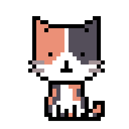
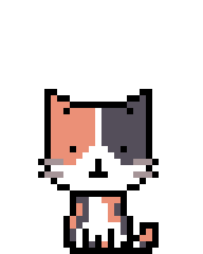
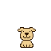
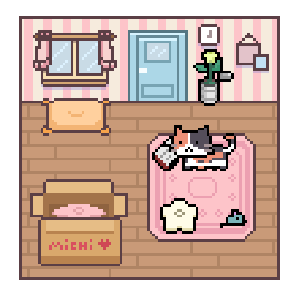
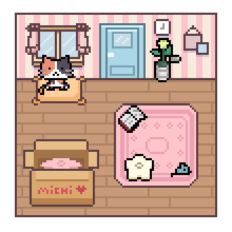
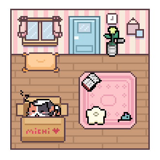
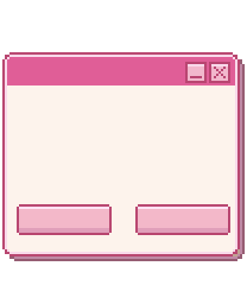

<a id="art-top"></a>

<div align="center">
  <h2>｡˚✦⋆ Ratito: art &amp; sprites ⋆✦˚｡</h2>
  <p>How the pets, rooms and little windows of Ratito are drawn, exported and put together.<br>
  <sub>The app itself lives in the <a href="README.md">main README</a>.</sub></p>
</div>

<details>
  <summary>Contents</summary>
  <ol>
    <li><a href="#two-kinds-of-sprites">Two kinds of sprites</a></li>
    <li><a href="#the-companions">The companions</a></li>
    <li><a href="#michis-room">Michi's room</a></li>
    <li><a href="#how-a-room-is-built">How a room is built</a></li>
    <li><a href="#sizes-cheat-sheet">Sizes cheat sheet</a></li>
    <li><a href="#workflow">Workflow</a></li>
    <li><a href="#coming-next">Coming next</a></li>
  </ol>
</details>

---

## Two kinds of sprites

Every companion has two sets of sprites, each for a different place in the app:

| | Front-facing | Top-down room |
|---|---|---|
| **Where** | Notice windows (pop-ups) | Focus page |
| **Moods / scenes** | idle, happy, sad | focus, pause, rest |
| **What's in the file** | just the pet | just the pet, placed inside its room |
| **Folder** | `assets/pets/<pet>/` | `assets/rooms/<pet>/` |

## The companions

<div align="center">
  <table>
    <tr>
      <td align="center"><br><b>Michi</b> · idle</td>
      <td align="center"><br><b>Michi</b> · happy</td>
      <td align="center"><br><b>Perrito</b> · idle</td>
    </tr>
  </table>
</div>

**Michi** is a calico cat who was abandoned. Her room is made of found things (a carton box with blankets, mismatched pillows, a little toy mouse), so it feels like she built a home for herself.
**Perrito** is a puppy with a warm, Hispanic-style home *(room in progress)*: terracotta tiles, papel picado and a hammock to nap in.

<p align="right">(<a href="#art-top">back to top</a>)</p>

## Michi's room

These are flattened previews of every layer per scene, only for this page. In the app the layers are stacked live (see below).

<div align="center">
  <table>
    <tr>
      <td align="center"><br><b>focus</b><br><sub>timer running: reading her book</sub></td>
      <td align="center"><br><b>pause</b><br><sub>paused / idle: playing with props</sub></td>
      <td align="center"><br><b>rest</b><br><sub>Pomodoro break: napping in her box</sub></td>
    </tr>
  </table>
</div>

<p align="right">(<a href="#art-top">back to top</a>)</p>

## How a room is built

A room isn't one big GIF. It's a stack of see-through layers, like sheets on top of each other. Only the pet moves; everything else is a still PNG.

```
top     box_front.png          front edge of the box (covers Michi when she naps)
        michi_<scene>.gif      the only animated layer
        box_back.png           inside of the box + blanket
        pillow_orange.png
        pillow_flw_ylw.png
        mouse_toy.png
        book.png               hidden during focus (see below)
        decor_plant.png        decor = future rewards
        decor_rug.png
        door.png
        blind.png
bottom  room_base.png          walls + floor
```

Why layers?

- **Draw the room once.** Switching focus → pause → rest only swaps the pet GIF.
- **Decor can become rewards later.** Each decor item is its own PNG, so the app can show it only when you've unlocked it.
- **Full-canvas trick.** Every layer is exported at the full 330 × 330 canvas with transparency around it, so they all sit at 0,0 and line up by themselves. No x/y positions needed.

Two rules that came up while drawing:

1. **Depth: split things the pet goes inside.** For Michi to sit *in* the box (not float on top of it), the box is split into `box_back` (under her) and `box_front` (over her). Perrito's hammock works the same way.
2. **Anything the pet touches goes into the pet's GIF.** While Michi reads, the page-turning book is drawn into `michi_focus_book.gif`, so it always stays in sync with her paw. Separate GIFs would drift apart. The still `book.png` only shows in pause and rest.

<p align="right">(<a href="#art-top">back to top</a>)</p>

## Sizes cheat sheet

Everything is drawn small and scaled up by **whole numbers** (×3) so the pixels stay crisp.

| Thing | Drawn at | In the app (×3) |
|---|---|---|
| Phone screen (reference) | 130 × 281 | 390 × 843 |
| Room | 110 × 110 | 330 × 330 |
| Front-facing pet | 32 × 40 | 96 × 120 |
| Notice window | 104 × 120 | 312 × 360 |
| Big button | 56 × 17 | 168 × 51 |

<div align="center">
  <br>
  <sub>The notice window. Text, the pet and the buttons are added by the app.</sub>
</div>

**Drawn vs. coded:** frames, buttons, icons and pets are drawn. All text, layout and button behaviour are code, so nothing has to be redrawn to change a message.

<p align="right">(<a href="#art-top">back to top</a>)</p>

## Workflow

### 1. Early sprites: Clip Studio Paint + pixel-up

The first idle sprites were drawn in Clip Studio Paint. CSP blurs pixels when it enlarges an animation on export, so I built a small Rust CLI for it: **[pixel-up](https://github.com/achoannie/pixel-up)**.

1. Draw on a small canvas (e.g. 64 × 64) and export at **100%** (no scaling = no blur).
2. pixel-up crops one square around the pet (the same for every frame, so it doesn't jump) and enlarges every pixel into a solid block (nearest neighbor).

### 2. Rooms: Aseprite

The rooms and newer sprites are made in Aseprite:

- **One layer per object**, named exactly like the file it becomes (`room_base`, `book`, `box_front`, …).
- **One tag per scene** on the timeline: `michi_rest`, `michi_pause`, `michi_focus`.
- Still layers have **linked cels**, drawn once on frame 1 and shown on every frame.
- The focus scene is a group, `michi_focus_book`, holding the `michi_focus` and `book_focus` layers.

### 3. Export: one script

Exporting 14 files by hand every time gets old, so Aseprite's command line does it:

```bash
A="/Users/pqa/Library/Application Support/Steam/steamapps/common/Aseprite/Aseprite.app/Contents/MacOS/aseprite"
SRC="$HOME/Desktop/ratito-art/room.aseprite"
OUT="${1:-export/michi}"
mkdir -p "$OUT"

# still layers: frame 1 only, ×3, one png per layer
for L in room_base blind door decor_rug decor_plant book mouse_toy pillow_flw_ylw pillow_orange box_back box_front; do
  "$A" -b "$SRC" --layer "$L" --frame-range 0,0 --scale 3 --save-as "$OUT/$L.png"
done

# animations: one gif per scene, ×3
"$A" -b "$SRC" --layer michi_rest       --tag michi_rest  --scale 3 --save-as "$OUT/michi_rest.gif"
"$A" -b "$SRC" --layer michi_pause      --tag michi_pause --scale 3 --save-as "$OUT/michi_pause.gif"
"$A" -b "$SRC" --layer michi_focus_book --tag michi_focus --scale 3 --save-as "$OUT/michi_focus_book.gif"
```

Run it from the repo: `bash export.sh assets/rooms/michi`

### 4. Into the app

`src/rooms/rooms.ts` lists each room's layers in stacking order. `RoomScene` draws them on top of each other and swaps the pet GIF depending on the timer.

<p align="right">(<a href="#art-top">back to top</a>)</p>

## Coming next

- [ ] Sad sprites for Michi and Perrito, happy sprite for Perrito
- [ ] Perrito's room: terracotta floor, talavera tiles, papel picado and a hammock (`hammock_back` / `hammock_front`)
- [ ] Pixel timer panel and hand-drawn timer digits
- [ ] App icon

<p align="right">(<a href="#art-top">back to top</a>)</p>
