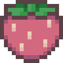
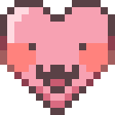
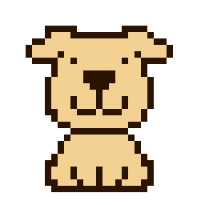
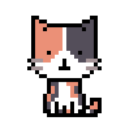
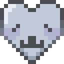

<a id="readme-top"></a>

<!-- PROJECT LOGO -->
<br />
<div align="center">
  <h2 align="center">｡˚✦⋆ Ratito ⋆✦˚｡</h2>

  <p align="center">
    <em>focus un ratito</em> — a cozy pixel-pet focus timer, so you never have to study alone.
    <br />
    <br />
    <a href="#getting-started"><strong>Run it locally »</strong></a>
    ·
    <a href="#usage">How it works</a>
    ·
    <a href="#roadmap">Roadmap</a>
  </p>
</div>

<!-- TABLE OF CONTENTS -->
<details>
  <summary>Table of Contents</summary>
  <ol>
    <li>
      <a href="#about-the-project">About The Project</a>
      <ul>
        <li><a href="#target-audience">Target Audience</a></li>
        <li><a href="#competitors">Competitors</a></li>
        <li><a href="#built-with">Built With</a></li>
        <li><a href="#art-workflow">Art workflow</a></li>
      </ul>
    </li>
    <li>
      <a href="#getting-started">Getting Started</a>
      <ul>
        <li><a href="#prerequisites">Prerequisites</a></li>
        <li><a href="#installation">Installation</a></li>
      </ul>
    </li>
    <li><a href="#usage">Usage</a></li>
    <li><a href="#roadmap">Roadmap</a></li>
    <li><a href="#project-structure">Project Structure</a></li>
    <li><a href="#contact">Contact</a></li>
    <li><a href="#acknowledgments">Acknowledgments</a></li>
  </ol>
</details>


<!-- ABOUT THE PROJECT -->
## About The Project

<!-- Add a screenshot of the Home screen here once it's final:
[![Ratito Screen Shot][product-screenshot]](#) -->

**Ratito** is a Pomodoro-style focus app where a little pixel pet keeps you company while you work.
*"Un ratito"* is Spanish for *"a little while"* — exactly how long a focus session is (and it also sounds like *little rat*, though so far, there isn't any rats yet for the sprites). 

Studying or working alone for hours can feel lonely, boring and hard to keep up. Some pomodoro apps only track time.
Ratito turns focus time into **time spent with/for someone**:

* **Focus sessions** — pick a duration and what you're focusing on (study, work, read…), then start the timer.
* **A pixel companion? pet? competnion!** — your companion (Perrito, Michi, …) sits with you and reacts to what you do: it focuses with you, rests when you pause, celebrates when you finish, and comforts you when you give up.
*  **Strawberries** — the in-app currency you and your companion earn while focusing, later used for skins, decor and new pets.
*  **Ratitude** — every companion has its own Ratitude (shown as hearts) that grows the more time you spend together. *(The name came from a dream.)*
* **Not alone** *(planned)* — add friends, see who's focusing, and leave each other little notes that are delivered when a session ends.

The design should be **calm, cozy and whimsical**: hand-drawn pixel art, soft colors, slow animations — a focus app that feels like a small, cute place rather than a bland productivity dashboard.

## Meet the companion (more companions in production)
<div align="center">
<table>
  <tr>
    <td align="center">
      <br>
      <b>Perrito</b>
    </td>
    <td align="center">
      <br>
      <b>Michi</b>
    </td>
  </tr>
</table>

</div>


### Target Audience

* **Students or anyone** working on a project who want to keep track of how much time they spend on it.
* People who want a **gentle push to stay productive** without pressure or guilt.
* People who enjoy *a sprinkle of* **whimsical and cute aesthetic** besides the focusing function.
* Fans of **cute animals, collecting, decor and gacha-style rewards**.
* People who like to **express themselves** and make their space their own.
* Anyone who feels **lonely while studying or working** and wants a companion (or friends) by their side.

### Competitors

| App | What it does | How Ratito is different |
|---|---|---|
| **Forest** | Grow a sprite tree while you stay off your phone, or pay a subscription to plant an actual tree | Ratito's reward is a *relationship*: a pet that reacts to you and grows Ratitude |
| **Focus Tree** | Similar reward system focus timer with 3D NFTs collection to decorate your garden | Hand-drawn pixel pets, a cozy whimsical style and a social/notes layer against loneliness |

Both are established apps backed by bigger teams or organization that have been around for years. Ratito focuses on something they don't: **companionship and a personal, cute aesthetic**.

<p align="right">(<a href="#readme-top">back to top</a>)</p>

### Built With

* [![Expo][Expo-badge]][Expo-url]
* [![React Native][ReactNative-badge]][ReactNative-url]
* [![TypeScript][TypeScript-badge]][TypeScript-url]
* [![Supabase][Supabase-badge]][Supabase-url]
* **Expo Router** — file-based navigation
* **Zustand** — app state (auth store)
* **expo-image** — animated pixel-art GIFs
* **Clip Studio Paint** — all pet and icon artwork, drawn by me
* **[pixel-up](https://github.com/achoannie/pixel-up)** — my own Rust CLI (I built during autumn break) that crops and enlarges the pixel-art sprites without blurring or breaking the original quality

Runs as a **PWA** (web) and on **iOS / Android** from one codebase.

<p align="right">(<a href="#readme-top">back to top</a>)</p>

### Art workflow

All sprites are hand-drawn pixel art. Clip Studio Paint blurs pixels when it enlarges animations during its exporting step,
so I built a small side tool for it: **[pixel-up](https://github.com/achoannie/pixel-up)**.

1. Draw the pet in Clip Studio Paint on a small canvas (e.g. 64×64)
2. Export the animation at **100%** (no scaling = no blur)
3. Run pixel-up: it crops one square around the pet (the same for every frame, so it doesn't jump)
   and enlarges every pixel into a solid block (nearest neighbor)
4. Put the result in `assets/pets/<pet>/` and register it in `src/pets/pets.ts`


<!-- GETTING STARTED -->
## Getting Started

### Prerequisites

* [Node.js](https://nodejs.org/) (LTS)
* npm
  ```sh
  npm install npm@latest -g
  ```
* Optional: Android Studio (Android emulator), Xcode (iOS simulator, macOS only) or the Expo Go app on your phone
* A free [Supabase](https://supabase.com) project (for real accounts)

### Installation

1. Clone the repo
   ```sh
   git clone https://github.com/github_username/repo_name.git
   cd repo_name
   ```
2. Install packages
   ```sh
   npm install
   ```
3. Create a `.env` file in the project root with your Supabase keys
   (*Project Settings → API* in the Supabase dashboard)
   ```sh
   EXPO_PUBLIC_SUPABASE_URL=https://your-project.supabase.co
   EXPO_PUBLIC_SUPABASE_ANON_KEY=your-anon-key
   ```
4. In Supabase, go to *Authentication → Sign In / Providers → Email* and turn off **Confirm email** (for easy testing)
5. Start the app
   ```sh
   npx expo start
   ```
   Press `w` for web, `a` for Android, `i` for iOS.

<p align="right">(<a href="#readme-top">back to top</a>)</p>


<!-- USAGE -->
## Usage

1. **Splash** — tap anywhere to begin.
2. **Register or log in** with email and password.
   <!-- Demo account for testing: email `demo@...` / password `...` (fill in once created) -->
3. **Home** — choose your companion with the ⇄ button, pick a duration and what you're focusing on, and press **Start**.
4. While the timer runs, your pet focuses with you. **Pause** to take a little break, **Resume** to continue, or **Give up** (no guilt — your pet just says *let's try again later ♡*).
5. Finish a session to earn  strawberries and grow your pet's  Ratitude .
6. Open the ☰ menu to visit the other pages and log out from **Settings**.

<p align="right">(<a href="#readme-top">back to top</a>)</p>


<!-- ROADMAP -->
## Roadmap

**Phase 1 — PWA (first assignment)**
- [x] Splash screen with hand-drawn pets
- [x] Register, login and logout with Supabase Auth
- [x] Home screen: focus timer (start / pause / resume / give up)
- [x] Pixel pets with mood animations and a pet switcher
- [x] Strawberry counter and Ratitude hearts (UI)
- [x] Side menu with placeholder pages
- [ ] Installable PWA (manifest, icons, offline)

**Phase 2 — Final app (native iOS & Android)**
- [ ] add pixel-up in `/script`: animated GIF output, then use it for all pet sprites
- [ ] Save strawberries, Ratitude and focus history in Supabase
- [ ] Rewards: earn strawberries and Ratitude when a session finishes
- [ ] Profile: stats of how long and on what you focused
- [ ] More moods per pet (focus, resting, happy, sad)
- [ ] Friends: add friends and see who's focusing
- [ ] Notes: leave a friend a message, delivered after their session
- [ ] Settings: account, sounds, theme
- [ ] Sound effects
- [ ] End-to-end tests (Cypress)

**Later / ideas**
- [ ] Shop: skins and decor for strawberries
- [ ] Shelter: a cozy room with all your pets
- [ ] More pets (bird, hamster, fish) and seasonal skins
- [ ] Daily check-in rewards and gentle streaks
- [ ] Gacha for rare pets and outfits

<p align="right">(<a href="#readme-top">back to top</a>)</p>


<!-- PROJECT STRUCTURE -->
## Project Structure

```
app/                  screens (Expo Router: every file is a page)
  splash.tsx          welcome screen
  login.tsx           login
  register.tsx        create an account
  (app)/              pages that need a logged-in user
    _layout.tsx       auth gate + ☰ menu
    index.tsx         Home: pet + focus timer
    settings.tsx      settings + log out
assets/               fonts, pixel-art pets and icons
src/
  components/         reusable UI (counter, hearts, side menu, …)
  lib/supabase.ts     Supabase connection
  pets/pets.ts        pet catalog (names + mood animations)
  services/           talks to Supabase (auth)
  state/              app state (auth store, session)
  theme/              colors and fonts
```

<p align="right">(<a href="#readme-top">back to top</a>)</p>


<!-- CONTACT -->
## Contact

Anh — UCLL, Mobile Applications

Project Link: [ratito-pomodoro-app](https://github.com/achoannie/ratito-pomodoro-app)

<p align="right">(<a href="#readme-top">back to top</a>)</p>


<!-- ACKNOWLEDGMENTS -->
## Acknowledgments

* [UCLL Mobile Applications starter code](https://github.com/ucllmobileapplications/boilerplate) - **[Niels Jacobs](https://github.com/NielsJacobsDev)**
* GIF and assets: drawn by **[Annie](https://github.com/achoannie)**
* Fonts: Grape Soda and Kiwi Soda ([DaFont](https://www.dafont.com)), [DotGothic16](https://fonts.google.com/specimen/DotGothic16)
* Inspiration: Forest, Focus Tree and cozy old-web pages like [cinni.net](https://cinni.net)
* [Best-README-Template](https://github.com/othneildrew/Best-README-Template)
* Sound Effect: sfxr.me
* [Some symbol effects inspo ✩₊˚୨☆( ◜⩊◝ )☆୧˚₊✩](kaomojis.jp)

<p align="right">(<a href="#readme-top">back to top</a>)</p>


<!-- MARKDOWN LINKS & IMAGES -->
[Expo-badge]: https://img.shields.io/badge/Expo-000020?style=for-the-badge&logo=expo&logoColor=white
[Expo-url]: https://expo.dev/
[ReactNative-badge]: https://img.shields.io/badge/React_Native-20232A?style=for-the-badge&logo=react&logoColor=61DAFB
[ReactNative-url]: https://reactnative.dev/
[TypeScript-badge]: https://img.shields.io/badge/TypeScript-3178C6?style=for-the-badge&logo=typescript&logoColor=white
[TypeScript-url]: https://www.typescriptlang.org/
[Supabase-badge]: https://img.shields.io/badge/Supabase-3FCF8E?style=for-the-badge&logo=supabase&logoColor=white
[Supabase-url]: https://supabase.com/